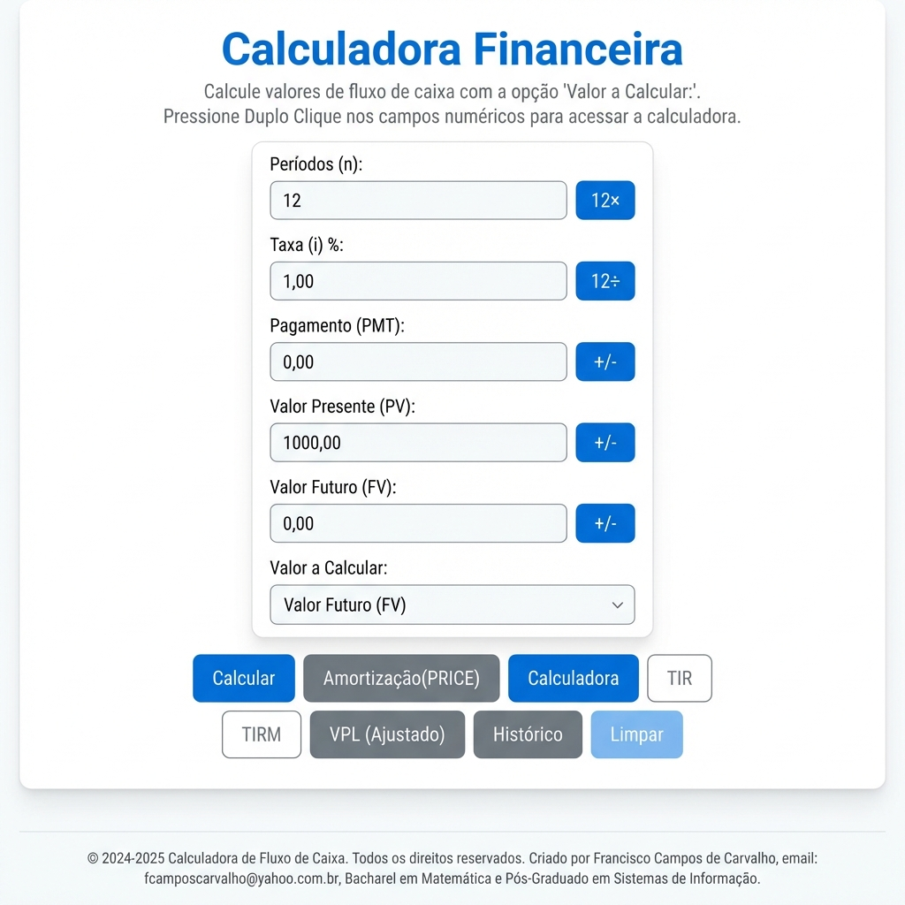

# Financial Calculator

An advanced cash flow calculator for financial calculations such as present value (PV), future value (FV), payments (PMT), interest rates and number of periods.



## Features

- **Complete time value of money calculations**:
  - Present Value (PV)
  - Future Value (FV)
  - Payments (PMT)
  - Interest rate (i)
  - Number of periods (n)
- **HP 12c sign convention**: money received is positive, money paid out is negative
- **Result cache** for better performance
- **Calculation history** with the last 10 calculations
- **Robust numerical methods**: Newton-Raphson with a bisection fallback for rates and IRR
- **Amounts rounded to the cent**, with half a cent rounded away from zero and no floating-point drift
- **Responsive interface** for every screen size
- **Clear messages** for invalid inputs and for cash flows without a solution
- **IRR (Internal Rate of Return)** with multiple cash flows
- **MIRR (Modified Internal Rate of Return)** with finance and reinvestment rates
- **NPV (Net Present Value)** with adjustable discount rates
- **RPN mode** (Reverse Polish Notation) for HP-style calculations, with the T, Z, Y, X stack on screen
- **Amortization schedules** with the PRICE (constant payment) and SAC (constant amortization) methods

## Number and date formats

- Numbers use the US format: `1,234.56` (comma for thousands, dot for decimals). `$` and `%` may be typed.
- Amounts are shown in US dollars (`$1,234.56`).
- The ΔDYS key (days between dates) uses the HP 12c M.DY format: `mm.ddyyyy` (e.g. `12.252026` = December 25, 2026).

## Technologies

- HTML5
- CSS3
- JavaScript (ES6+)
- Modern UI/UX techniques
- Financial mathematics

## How to Use

### Installation

1. Clone this repository:
```bash
git clone https://github.com/fcamposcarvalho/financialcalculator.git
```
2. Open `index.html` in any modern browser

### Online

Use the calculator directly at: [https://fcamposcarvalho.github.io/financialcalculator](https://fcamposcarvalho.github.io/financialcalculator)

### Adding it to other sites

To add this calculator to your site:

1. Copy `index.html`
2. Copy all `.css` files (calculator.css, calculator_irr.css, calculator_mirr.css, calculator_npv.css)
3. Copy all `.js` files (financialcalculator.js, calculator.js, calculator_irr.js, calculator_mirr.js, calculator_npv.js)

## User Guide

1. **Select the value to calculate** in the drop-down menu
2. **Fill in the known fields**
3. **Click "Calculate"** to get the result
4. Use the **+/-** buttons to change signs when needed
5. See the **calculation history** with the "History" button
6. Use the advanced functions through the **IRR**, **MIRR** or **NPV** buttons

## Common Use Cases

### Loan payments
- Enter the loan amount as the Present Value (positive)
- Enter the number of periods
- Enter the interest rate
- Set Future Value = 0
- Select "Payment (PMT)" in the drop-down menu
- Calculate

### Time to reach a savings goal
- Enter the Present Value (initial deposit, negative)
- Enter the interest rate
- Enter the periodic deposit (PMT, negative)
- Enter the desired future value (positive)
- Select "Periods (n)" in the drop-down menu
- Calculate

### IRR (Internal Rate of Return)
- Click the "IRR" button
- Enter the initial investment (negative)
- Add cash flow rows for each period
- Click "Calculate IRR"

## Mathematical Background

The calculator implements the following financial formulas (end-of-period payments):

- **Time value of money equation**: `PV·(1+i)^n + PMT·((1+i)^n − 1)/i + FV = 0`

- **Present Value (PV)**:
  - With PMT=0: `PV = −FV / (1+i)^n`
  - General case: `PV = −PMT·(1−(1+i)^−n)/i − FV·(1+i)^−n`

- **Future Value (FV)**:
  - With PMT=0: `FV = −PV·(1+i)^n`
  - General case: `FV = −PMT·((1+i)^n−1)/i − PV·(1+i)^n`

- **Numerical methods**:
  - Closed form, with a binary search fallback, for the number of periods
  - Newton-Raphson, with a bisection fallback, for rates and IRR

## Project Structure

```
financialcalculator/
│
├── index.html              # Main HTML file
├── financialcalculator.js  # Main financial calculation logic
├── calculator.js           # Calculator with ALG and RPN modes
├── calculator_irr.js       # IRR (Internal Rate of Return) module
├── calculator_mirr.js      # MIRR (Modified IRR) module
├── calculator_npv.js       # NPV (Net Present Value) module
├── calculator.css          # Main CSS styles
├── calculator_irr.css      # IRR modal styles
├── calculator_mirr.css     # MIRR modal styles
├── calculator_npv.css      # NPV modal styles
├── financialcalculator.png # Screenshot of the calculator
└── README.md               # This file
```

## Future Improvements

- [ ] Charts for visualization
- [ ] PDF export of results
- [ ] Additional financial functions
- [ ] Customizable visual themes

## License

This project is licensed under the MIT license - see the [LICENSE](LICENSE) file for details.

## Credits

Originally developed for the [Cabala e Matemática](https://cabalaematematica.com.br/) website as an educational and practical tool for financial calculations.

## Contributing

Contributions are welcome! To contribute:

1. Fork the project
2. Create a branch for your feature (`git checkout -b feature/new-feature`)
3. Commit your changes (`git commit -am 'Add new feature'`)
4. Push to the branch (`git push origin feature/new-feature`)
5. Open a Pull Request

---

© 2025 Financial Calculator | All rights reserved.
